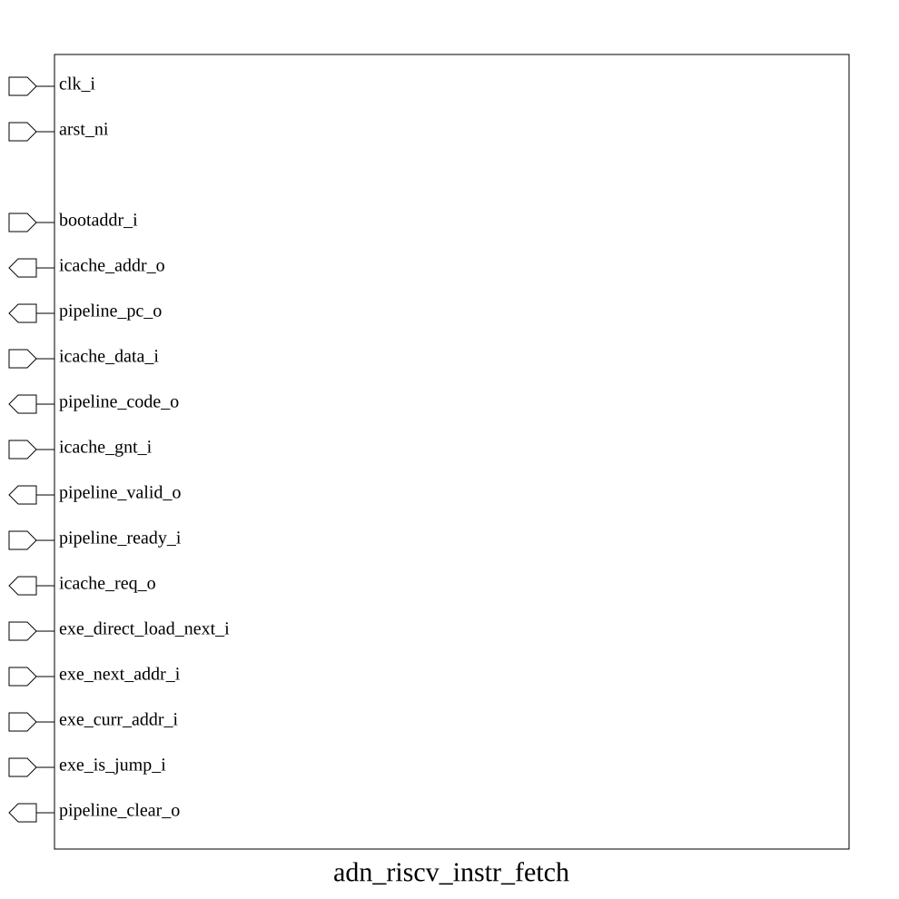

# adn_riscv_instr_fetch (module)

### Author: Reyad07 (mreyad30207@gmail.com)

### Source: adn_riscv_instr_fetch.sv

## Top IO

## Parameters

_None_

## Description

@foez---bhai, write the purpose of this module in markdown format here. This is already in multi-line comment, so don't add any additional comment syntax.

@foez---bhai, describe the use case of this module in markdown format here. This is already in multi-line comment, so don't add any additional comment syntax.

| REVISION | DATE       | AUTHOR          | DESCRIPTION                                            |
|----------|------------|-----------------|--------------------------------------------------------|
| 0.1      | 2026-11-23 | Reyad07 | Initial version                                        |
| 1.0      | 2026-11-23 | Reyad07 | Stable release                                         |

Author : Reyad07 (mreyad30207@gmail.com)
